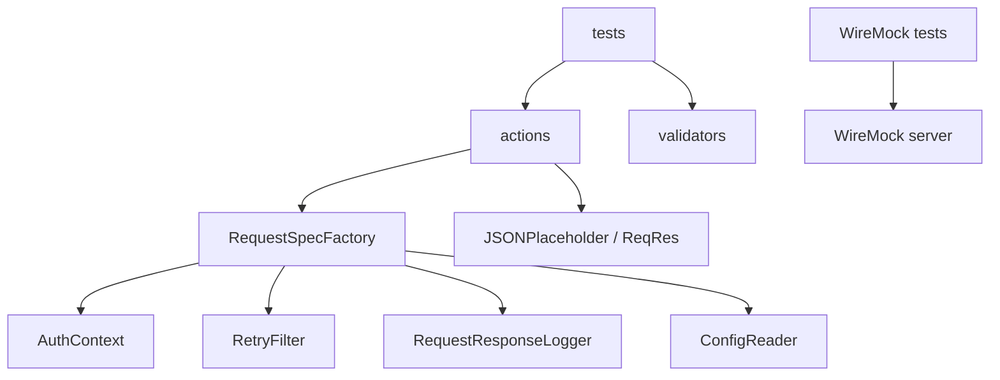

# api-restassured-java-framework

REST API test automation with **Java · RestAssured · TestNG · JSON Schema · Allure · WireMock**.

Targets [JSONPlaceholder](https://jsonplaceholder.typicode.com) (CRUD), [ReqRes.in](https://reqres.in) (login / Bearer), and local **WireMock** stubs (auth, cookies, retry).

## Architecture

```text
tests/            Thin scenarios (live + WireMock)
validators/       Status / schema / soft asserts
actions/          HTTP calls (PostActions, AuthActions, UserActions)
endpoints/        Path constants
client/           RequestSpecFactory, AuthContext, RetryFilter, logging
wiremock/         Local stub server manager
models/           DTOs (Post, LoginRequest, User)
config/           Multi-env properties + overrides
```



## Prerequisites

- JDK 17+
- Maven Wrapper included (`mvnw` / `mvnw.cmd`)

## Run

```powershell
$env:JAVA_HOME = "C:\Program Files\Java\jdk-17"
$env:Path = "$env:JAVA_HOME\bin;$env:Path"
cd c:\Users\prasa\Downloads\api-restassured-java-framework

# Sanity suite (default) — JSONPlaceholder only
.\mvnw.cmd test

# Full suite (Posts + ReqRes + WireMock)
.\mvnw.cmd test "-DsuiteXmlFile=src/test/resources/testng.xml"

# Parallel methods (thread-count=3)
.\mvnw.cmd test "-DsuiteXmlFile=src/test/resources/parallel-suite.xml"

# WireMock only (offline stubs)
.\mvnw.cmd test "-DsuiteXmlFile=src/test/resources/wiremock-suite.xml"

# ReqRes only (live auth / users)
.\mvnw.cmd test "-DsuiteXmlFile=src/test/resources/reqres-suite.xml"

# Env profile (dev | qa | stage)
.\mvnw.cmd test "-Denv=qa"

# Allure
.\mvnw.cmd allure:serve
```

Reports:

- Extent: `reports/extent-report.html`
- Allure: `.\mvnw.cmd allure:serve`

## Multi-env config

| Profile | File | Select with |
|---------|------|-------------|
| dev (default) | `config.properties` | `-Denv=dev` or omit |
| qa | `config-qa.properties` | `-Denv=qa` or `ENV=qa` |
| stage | `config-stage.properties` | `-Denv=stage` |

Optional local overrides: `config.local.properties` (gitignored).

| Key | Env var | Purpose |
|-----|---------|---------|
| `base.uri` | `BASE_URI` | JSONPlaceholder base |
| `reqres.base.uri` | `REQRES_BASE_URI` | ReqRes base |
| `reqres.api.key` | `REQRES_API_KEY` | ReqRes `x-api-key` (default `reqres-free-v1`) |
| `auth.bearer.token` | `AUTH_BEARER_TOKEN` | Optional static Bearer |
| `retry.max.attempts` | `RETRY_MAX_ATTEMPTS` | RetryFilter attempts |
| `retry.delay.ms` | `RETRY_DELAY_MS` | Delay between retries |
| `log.request.response` | `LOG_REQUEST_RESPONSE` | Full HTTP logging |

## Auth, headers, cookies

- `AuthContext` (ThreadLocal): `setBearerToken`, `addHeader`, `addCookie`
- Applied automatically by `RequestSpecFactory`
- Cleared in `@BeforeMethod` / `@AfterMethod` for parallel safety
- Live demo: ReqRes `POST /api/login` → token (demo user `eve.holt@reqres.in` / `cityslicka`); `/api/*` uses `x-api-key`
- Stub demo: WireMock Bearer + `Set-Cookie` / cookie session (true Bearer-protected resource)
- OAuth2 authorization-code is out of scope; pattern is the same once you hold an access token (set Bearer)

## Retry / logging / soft asserts

- `RetryFilter` — retries on HTTP 5xx and connection errors
- `RequestResponseLogger` — toggled by `log.request.response`
- `SoftAssertHelper` — collect multiple field checks, then `assertAll()`

## Parallel execution

```powershell
.\mvnw.cmd test "-DsuiteXmlFile=src/test/resources/parallel-suite.xml"
```

Uses `parallel="methods"` with `thread-count="3"`. Auth and Extent reporting use `ThreadLocal`.

## WireMock

Local stubs (no internet) for interview demos:

- Bearer-protected `/secure/profile`
- Cookie session `/session` → `/session/me`
- Flaky `/flaky` (503 → 503 → 200) to prove `RetryFilter`

```powershell
.\mvnw.cmd test "-DsuiteXmlFile=src/test/resources/wiremock-suite.xml"
```

## CI

GitHub Actions runs the **sanity suite** on every push/PR (JSONPlaceholder only — fast and stable).

Upload artifacts: Extent report + Allure results.
