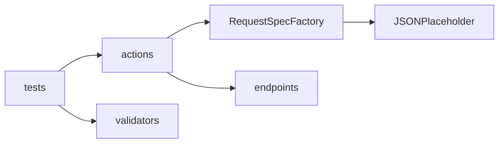

# api-restassured-java-framework

REST API test automation with **Java · RestAssured · TestNG · JSON Schema · Allure**.

Targets [JSONPlaceholder](https://jsonplaceholder.typicode.com) for GET / POST / PUT / PATCH / DELETE, including negatives and data-driven creates.

## Architecture

```text
tests/          Thin scenarios
validators/     Status / schema / field assertions
actions/        HTTP calls (PostActions)
endpoints/      Path constants
client/         Shared RequestSpecification
models/         DTOs (Post)
config/         base.uri + env overrides
```



## Prerequisites

- JDK 17+
- Maven Wrapper included (`mvnw` / `mvnw.cmd`)

## Run

```powershell
$env:JAVA_HOME = "C:\Program Files\Java\jdk-17"
$env:Path = "$env:JAVA_HOME\bin;$env:Path"
cd c:\Users\prasa\Downloads\api-restassured-java-framework

# Sanity suite (default)
.\mvnw.cmd test

# Or full suite
.\mvnw.cmd test "-DsuiteXmlFile=src/test/resources/testng.xml"

# Allure
.\mvnw.cmd allure:serve
```

Reports:

- Extent: `reports/extent-report.html`
- Allure: `.\mvnw.cmd allure:serve`

## Config

| Key | Env | Default |
|-----|-----|---------|
| `base.uri` | `BASE_URI` | `https://jsonplaceholder.typicode.com` |

## CI

GitHub Actions runs the **sanity suite** on every push/PR (real HTTP calls to JSONPlaceholder — no emulator needed).
